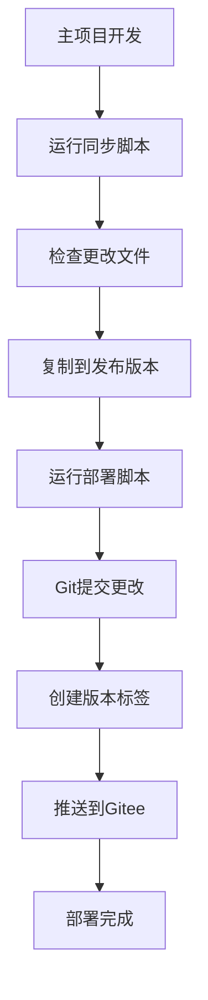

# KBird 自动化部署指南

## 🎯 概述

本指南介绍如何使用自动化脚本将KBird项目同步到发布版本并推送到Gitee。

## 📋 脚本说明

### 1. 同步脚本 (`sync-to-release.ps1`)
将主项目的更改同步到 `KBird-release` 发布版本目录。

**使用方法:**
```powershell
# 基本同步
.\sync-to-release.ps1

# 指定版本
.\sync-to-release.ps1 -Version "v1.2.0"

# 预览模式（不实际复制文件）
.\sync-to-release.ps1 -DryRun

# 强制同步
.\sync-to-release.ps1 -Force
```

### 2. 部署脚本 (`deploy-to-gitee.ps1`)
将发布版本推送到Gitee仓库。

**使用方法:**
```powershell
# 基本部署
.\deploy-to-gitee.ps1

# 指定版本和提交信息
.\deploy-to-gitee.ps1 -Version "v1.2.0" -Message "添加新功能"

# 指定Gitee仓库地址
.\deploy-to-gitee.ps1 -GiteeRepo "https://gitee.com/your-username/kbird.git"

# 预览模式
.\deploy-to-gitee.ps1 -DryRun
```

### 3. 自动化脚本 (`auto-update.ps1`)
一键完成同步和部署的完整流程。

**使用方法:**
```powershell
# 完整自动化更新
.\auto-update.ps1

# 指定版本和仓库
.\auto-update.ps1 -Version "v1.2.0" -GiteeRepo "https://gitee.com/your-username/kbird.git"

# 只同步，不部署
.\auto-update.ps1 -SkipDeploy

# 只部署，不同步
.\auto-update.ps1 -SkipSync

# 预览模式
.\auto-update.ps1 -DryRun
```

## 🚀 快速开始

### 1. 首次设置

1. **配置Gitee仓库地址:**
   ```powershell
   # 编辑 deploy-config.json 文件
   # 将 "repository" 字段改为你的Gitee仓库地址
   ```

2. **初始化Git仓库:**
   ```powershell
   cd KBird-release
   git init
   git remote add origin https://gitee.com/your-username/kbird.git
   ```

### 2. 日常更新流程

```powershell
# 方法1: 一键自动化更新
.\auto-update.ps1

# 方法2: 分步执行
.\sync-to-release.ps1
.\deploy-to-gitee.ps1
```

## 📊 工作流程



## 🔧 配置选项

### 版本管理
- 自动版本号: `v{日期}` 格式
- 手动版本号: 通过 `-Version` 参数指定
- 版本标签: 自动创建Git标签

### 文件同步
- 包含目录: components, pages, server, styles, public, data, utils, scripts, middleware
- 包含文件: package.json, next.config.js, docker-compose.yml 等配置文件
- 排除目录: node_modules, logs, uploads, backups, .git, .next

### Git操作
- 自动提交: 检测文件更改并自动提交
- 自动标签: 为每个版本创建Git标签
- 强制推送: 处理冲突时自动强制推送

## 🛠️ 故障排除

### 常见问题

1. **同步失败**
   ```powershell
   # 检查源目录是否存在
   Test-Path "components"
   
   # 检查目标目录权限
   Get-Acl "KBird-release"
   ```

2. **Git推送失败**
   ```powershell
   # 检查远程仓库配置
   git remote -v
   
   # 检查网络连接
   ping gitee.com
   ```

3. **权限问题**
   ```powershell
   # 以管理员身份运行PowerShell
   Set-ExecutionPolicy -ExecutionPolicy RemoteSigned -Scope CurrentUser
   ```

### 调试模式

```powershell
# 启用详细输出
$VerbosePreference = "Continue"

# 预览模式（不实际执行）
.\auto-update.ps1 -DryRun

# 分步调试
.\sync-to-release.ps1 -DryRun
.\deploy-to-gitee.ps1 -DryRun
```

## 📝 最佳实践

1. **定期更新**: 建议每次完成功能开发后立即更新
2. **版本管理**: 使用语义化版本号（如 v1.2.0）
3. **测试验证**: 更新后测试发布版本是否正常工作
4. **文档更新**: 同步时更新README.md和部署文档
5. **备份策略**: 重要更新前备份当前发布版本

## 🔗 相关文件

- `sync-to-release.ps1` - 同步脚本
- `deploy-to-gitee.ps1` - 部署脚本  
- `auto-update.ps1` - 自动化脚本
- `deploy-config.json` - 配置文件
- `KBird-release/` - 发布版本目录

## 📞 技术支持

如有问题，请检查：
1. 脚本日志输出
2. Git仓库状态
3. 网络连接状态
4. 文件权限设置

---

**注意**: 建议在生产环境使用前先在测试环境验证脚本的正确性。
