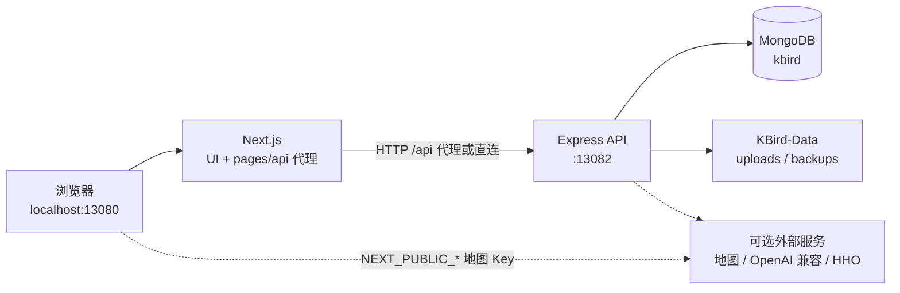

# KBird

本机观鸟笔记本：名录、观察记录与照片归档。

[](./CHANGELOG.md)
[](.github/workflows/ci.yml)
[](./LICENSE)
[](./package.json)
[](./package.json)
[](./package.json)
[](./package.json)

仓库：
- Gitee：https://gitee.com/fralium/kbird.git
- GitHub：https://github.com/fralium/kbird-project

当前正式版 **v1.1.1**，更新说明见 [CHANGELOG.md](./CHANGELOG.md)。

## 项目简介

KBird 是面向个人观鸟者的**本机优先** Web 应用：管理鸟种文字名录、记录观察、保存照片与鸣声，并汇总地点与个人统计。  
Clone 后自带公开**文字**种子名录；地点、观察记录、照片等个人数据落在仓库外的 `KBird-Data`，默认不进 Git。  
默认 `SINGLE_USER_MODE`，支持本机回环自动登录；地图与 AI 为可选项，需自备服务商 Key。  
前端 Next.js，后端 Express + MongoDB；Windows 提供 bat / PowerShell 一键安装与启停。

| 进仓库 | 不进仓库（本机私有） |
|--------|----------------------|
| 程序、文字名录、AI 封面 / 首页背景 | 地点、各地鸟种、自留地、探索数据、记录、照片、MongoDB |

## 界面预览


## 功能特性

### 前端

- 鸟种名录浏览 / 搜索 / 详情（Classic / Notebook 等视图）
- 观察记录列表、快速录入、草稿与表格视图
- 地点名录、地图展示（百度 / 天地图 / Leaflet 兜底，可选 Key）
- 个人中心：清单、目标、统计、照片、备份恢复、导入导出、记事本
- AI 助手页（对话 / 识鸟，需配置 Key）

### 后端

- REST API：鸟种、记录、地点、地区名录、用户与个人模块
- JWT 鉴权；管理员角色控制写名录等操作
- 上传（图片 / 鸣声）、限流、校验与统一错误处理
- 可选 OpenAI 兼容聊天 / 识鸟，以及 HHO 识鸟接口

### 通用

- 个人数据与程序分离（`KBird-Data`）
- 备份脚本：`uploads` + `mongodump` → zip
- 公开鸟种文字种子导出与分享卫生检查脚本
- Docker Compose / PM2 / GitHub Actions CI（lint、test、build）

## 技术栈

| 分层 | 技术 | 版本 | 用途 |
|------|------|------|------|
| 前端框架 | Next.js | ^16.2.4 | App Router 页面 + `pages/api` 反向代理 |
| UI | React / antd | ^19.2.0 / ^5.8.4 | 界面与组件 |
| 后端 | Express | ^4.18.2 | HTTP API（默认端口 13082） |
| ODM | Mongoose | ^7.4.3 | MongoDB 访问 |
| 数据库 | MongoDB | 本机 4.4+；Compose 镜像 6.0 | 持久化 |
| 鉴权 | jsonwebtoken / bcryptjs | ^9.0.2 / ^3.0.2 | JWT + 密码哈希 |
| 地图 | Leaflet 等 | ^1.9.4 | 地图展示；百度/天地图为可选 SDK |
| 包管理 | npm | lockfile 已提交 | 依赖安装 |
| 进程（可选） | PM2 | 见 `ecosystem.config.js` | 生产双进程 |
| 运行时 | Node.js | >=20.9.0 | `engines` 要求 |

## 系统架构



## 目录结构

```bash
kbird/
├── app/                 # Next.js App Router 页面
├── pages/               # 兼容层与 pages/api（转发到 Express）
├── components/          # React 组件
├── styles/              # CSS Modules / globals
├── server/              # Express 入口、路由、模型、中间件
├── utils/               # 前后端共用工具
├── data/                # 静态分类/别名等数据
├── seeds/               # 公开鸟种文字种子等
├── scripts/             # 安装、备份、Windows 启停、维护脚本
│   └── windows/         # install / setup-mongodb / Start|Stop 等
├── docs/                # 使用与排障文档
├── tests/               # node:test 冒烟测试
├── public/              # 静态资源
├── env.example          # 环境变量模板（复制为 .env）
├── docker-compose.yml   # Mongo + 应用（可选）
├── Dockerfile
├── ecosystem.config.js  # PM2
├── LICENSE              # 非商业许可
├── KBird-Start*.bat     # Windows 日常入口（转调 scripts/windows）
└── package.json
```

## 快速开始

### 前置要求

- Windows 10 / 11（主路径；Linux/macOS 可用 npm 脚本）
- Node.js **≥ 20.9**
- MongoDB（本机服务 4.4+；或 Docker Compose 中的 `mongo:6.0`）
- 完整备份另需 [MongoDB Database Tools](https://www.mongodb.com/try/download/database-tools)（`mongodump`）

### 克隆与安装

**推荐（Windows）** — 在**管理员** PowerShell 中：

```powershell
git clone https://gitee.com/fralium/kbird.git
cd kbird

.\scripts\windows\install.ps1
# 若还没有 MongoDB：
.\scripts\windows\setup-mongodb.ps1
# 空库首次：导入公开鸟种文字种子
.\scripts\windows\init-database.ps1
```

`install.ps1` 会安装依赖、准备 `.env`，并在仓库同级创建 `KBird-Data`。

**手动（npm）**

```bash
git clone https://gitee.com/fralium/kbird.git
cd kbird
copy env.example .env   # Windows；或 cp env.example .env
npm ci                  # 或 npm install
```

本仓库为单体（前端 + 后端同 `package.json`），无独立 frontend/backend 包。

### 环境变量

完整注释见 [`env.example`](./env.example)。常用项：

| 变量名 | 说明 | 示例值 | 必填 |
|--------|------|--------|------|
| `MONGODB_URI` | MongoDB 连接串（含库名） | `mongodb://localhost:27017/kbird` | 是 |
| `JWT_SECRET` | JWT 签名密钥 | `your-jwt-secret-here` | 是 |
| `PORT` | Express 端口 | `13082` | 否（默认 13082） |
| `NEXT_PUBLIC_API_URL` | 浏览器访问的 API 根 | `http://localhost:13082` | 是 |
| `SITE_URL` | 站点 URL | `http://localhost:13080` | 否 |
| `KBIRD_DATA_ROOT` | 个人数据根目录 | `your-path-to-KBird-Data` | 否（默认同级） |
| `UPLOAD_PATH` | 上传目录 | `your-uploads-path` | 否 |
| `SINGLE_USER_MODE` | 单机模式 | `true` | 否 |
| `AUTO_LOGIN` | 回环自动登录 | `true` | 否 |
| `DEFAULT_USER` | 自动登录用户名 | `admin` | 否 |
| `ENABLE_REGISTRATION` | 是否开放注册 | `false` | 否 |
| `NODE_ENV` | `development` / `production` | `development` | 否 |
| `NEXT_PUBLIC_BAIDU_MAP_AK` | 百度地图浏览器 AK | `your-baidu-ak-here` | 否 |
| `NEXT_PUBLIC_TIANDITU_TK` | 天地图浏览器 TK | `your-tianditu-tk-here` | 否 |
| `TIANDITU_SERVER_TK` | 天地图服务端 TK | `your-tianditu-server-tk-here` | 否 |
| `OPENAI_API_KEY` | OpenAI 兼容 API Key | `your-openai-api-key-here` | 否 |
| `OPENAI_BASE_URL` | 兼容接口 Base URL | `your-openai-base-url-here` | 否 |
| `OPENAI_MODEL` | 模型名 | `your-model-name-here` | 否 |
| `HHO_API_KEY` | HHO 识鸟 Key | `your-hho-api-key-here` | 否 |
| `CORS_ORIGINS` | 额外 CORS 源 | `your-origin-here` | 否 |
| `INIT_SETUP_TOKEN` | `/init` 保护头（可选） | `your-setup-token-here` | 否 |

**不要**将含真实密钥的 `.env` 提交到 Git。地图/AI 也可在本机「个人设置 → 服务与密钥」写入（仅 127.0.0.1），保存后需重启。

### 启动

**1）Windows 日常（推荐）**

```batch
KBird-Start-Prod.bat
```

首次会自动 `npm run build`，之后一般只做 `next start`。改过前端代码后需再构建一次。  
开发热更新：`KBird-Start.bat`（旧名 `KBird-Desktop.bat` 仍可用）。  
停止：`KBird-Stop.bat`。  
桌面快捷方式：`Create-Desktop-Shortcut.bat`。

**2）npm 分进程 / 一并启动**

```bash
npm run server          # 后端 API，端口 13082
npm run dev             # 前端开发，端口 13080
npm run dev:all         # 开发：前后端一并

npm run build
npm run prod:all        # 生产：已构建前端 + 后端一并
```

**3）Docker Compose**

```bash
# 需本机提供 JWT_SECRET 等（compose 读取 ${JWT_SECRET}）
docker compose up -d --build
```

说明：`Dockerfile` 基镜像为 `node:18-alpine`，与 `engines.node >=20.9` **不一致**；Compose 内 Mongo 为 **6.0**。日常更推荐本机 Node≥20.9 + 本机 Mongo。

**4）PM2（可选）**

```bash
npm run build
npm run pm2:start
```

### 访问地址

| 服务 | 地址 |
|------|------|
| 前端 | http://localhost:13080 |
| 后端 API | http://localhost:13082（根路径返回 JSON 简介；无 Swagger `/docs`） |
| 初始化探测 | http://localhost:13082/api/check-init |

单机模式下后端会按默认就绪本机数据与管理员；密码可在个人设置中修改。`/init` 仅为特殊重配页，日常不必打开。

## 更新程序

```batch
KBird-Update.bat
```

或：`.\scripts\windows\update.ps1`  
会停止 Node → `git pull` → `npm install` → 检查 `KBird-Data`；**不**覆盖 `.env` 与个人数据。

## 备份

```batch
KBird-Backup.bat
```

或：`.\scripts\backup-personal-data.ps1`  
zip 输出在同级 `KBird-Data\backups\`。建议另拷一份到其他盘或外置介质。

## API 概览

前缀为 Express 上的 `/api/...`（也可经 Next `pages/api` 同源代理）。代表性路由：

| 方法 | 路径 | 说明 | 鉴权 |
|------|------|------|------|
| GET | `/` | API 服务信息 | 否 |
| GET | `/api/check-init` | 是否已初始化 | 否 |
| POST | `/api/init` | 初始化/覆盖管理员（本机约束） | 条件 |
| POST | `/api/users/login` | 登录，返回 JWT | 否 |
| POST | `/api/users/local-session` | 单机回环自动登录 | 否（限回环） |
| POST | `/api/users/register` | 注册 | 否（单机默认可关闭） |
| GET | `/api/users/profile` | 当前用户资料 | 是 |
| GET | `/api/birds` | 鸟种列表 | 否 |
| GET | `/api/birds/:id` | 鸟种详情 | 否 |
| POST/PUT/DELETE | `/api/birds...` | 名录维护 / 图片鸣声等 | 是（多为 admin） |
| GET | `/api/records` | 已发布观察记录列表 | 否 |
| GET | `/api/records/:id` | 记录详情 | 否 |
| POST/PUT/DELETE | `/api/records...` | 创建/编辑/删除记录 | 是 |
| GET | `/api/locations` | 地点列表 | 否 |
| POST/PUT/DELETE | `/api/locations...` | 地点写操作 | 是 |
| GET | `/api/search` | 全局搜索 | 否 |
| GET | `/api/personal/stats/*` | 个人统计 | 是 |
| GET/POST | `/api/personal/backup/*` | 备份导出 / 恢复 | 是 |
| * | `/api/ai/*` | AI 状态、对话、识鸟 | 是 |
| GET | `/api/tianditu/geocode` | 天地图地理编码 | 是 |
| GET | `/api/admin/*` | 管理端指标等 | 是（admin） |

鉴权：请求头 `Authorization: Bearer <token>`。

## 部署

- **本机 Windows（主推）**：上文 bat / `scripts/windows/*`，详见 [docs/WINDOWS_QUICK_START.md](docs/WINDOWS_QUICK_START.md)
- **Docker Compose**：`docker compose up -d --build`（端口 13080 / 13082；Mongo 绑 `127.0.0.1:27017`）
- **CI**：[`.github/workflows/ci.yml`](.github/workflows/ci.yml) — `npm ci` → lint → test → build（Node 20）
- **PM2**：`ecosystem.config.js` — 先 `npm run build` 再 `npm run pm2:start`

## 常见问题

1. **前端能开、数据全失败（Failed to fetch）** — 多半未起 Express 或 MongoDB。检查 `:13082` 与 Mongo 服务；用 `KBird-Start.bat` / `npm run dev:all`。见 [docs/TROUBLESHOOTING.md](docs/TROUBLESHOOTING.md)。
2. **Prod 改代码界面不变** — 需重新 `npm run build` 或再跑 `KBird-Start-Prod.bat` 构建流程。
3. **登录反复失效** — 检查 `.env` 的 `JWT_SECRET`；浏览器清除 `localStorage` 后重登。
4. **端口占用** — `netstat -ano | findstr :13080` / `:13082`；或改 `PORT` 与 `NEXT_PUBLIC_API_URL` / `SITE_URL` 保持一致。
5. **备份缺库** — 需安装 `mongodump`；或先 `-SkipMongo` 只备照片。

## 文档

- [docs/README.md](docs/README.md) — 文档索引
- [docs/DATA_ISOLATION.md](docs/DATA_ISOLATION.md) — 数据隔离与备份
- [docs/MAP_SETUP.md](docs/MAP_SETUP.md) — 地图配置
- [docs/GITEE_SHARE_GUIDE.md](docs/GITEE_SHARE_GUIDE.md) — 公开分享前检查

### 开发常用命令

```powershell
npm install
npm run lint
npm test
npm run build
node scripts/export-public-bird-seed.js
node scripts/check-share-hygiene.js
```

## 贡献

1. 克隆仓库并创建分支  
2. `npm ci` 后改动代码  
3. `npm run lint` 与 `npm test` 通过  
4. 提交变更并说明动机与验证步骤  

推送公开仓库前建议运行：`node scripts/check-share-hygiene.js`。

## 版权与许可

本项目采用 **非商业许可**（见根目录 [LICENSE](./LICENSE)）：

- 允许：个人、教学、科研与无偿分享下的使用、修改与分发  
- 禁止：未授权商用（售卖、付费托管 / SaaS、捆绑收费产品等）  
- 商业合作需另行书面授权  

公开种子只含文字名录；照片与观察记录等个人数据归使用者所有。使用地图 / AI 时请遵守对应服务商条款。
