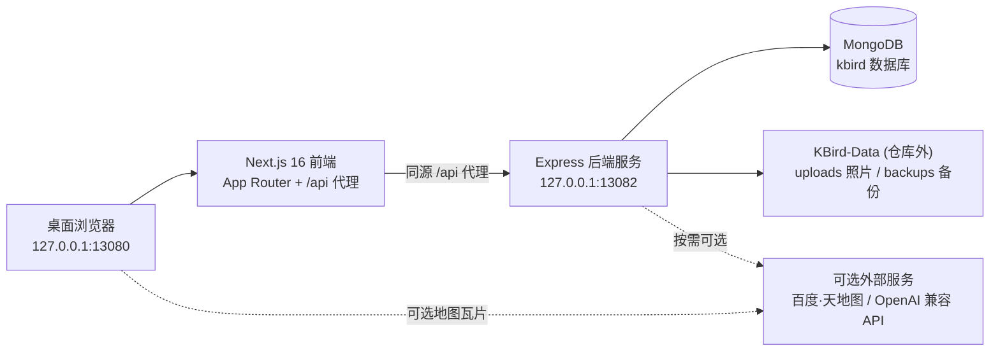

<div align="center">

# KBird · 个人本地观鸟笔记本

**本机优先（Local-First）的观鸟记录、影像归档、物种辨识对比与驻地物候分析系统**

[](./CHANGELOG.md)
[](.github/workflows/ci.yml)
[](./package.json)
[](./package.json)
[](./package.json)
[](./package.json)
[](./LICENSE)

[Gitee 主仓库](https://gitee.com/fralium/kbird.git) · [GitHub 镜像仓库](https://github.com/fralium/kbird-project) · [版本更新日志 (CHANGELOG)](./CHANGELOG.md) · [Windows 快速上手](./docs/WINDOWS_QUICK_START.md) · [常见问题排障](./docs/TROUBLESHOOTING.md)

</div>

---

## 为什么做 KBird？

许多观鸟者在几年间积累了成百上千份野外记录和数万张按鸟种分类的实拍照片，却常常面临三个痛点：
1. **照片与记录割裂**：硬盘文件夹里的鸟照只有文件名，没法和当天的观鸟记录、地点与物候关联起来；
2. **长期驻地（自留地）缺乏纵深统计**：常去的公园或湿地，很难直观看出今年候鸟比往年早到了几天、历年常客留存率是多少；
3. **云端平台的隐私与离线顾虑**：珍贵的私人鸟点坐标、未公开观察记录以及海量原图，更希望 100% 掌握在自己本机硬盘中。

**KBird** 为此而生——它是一套运行在你个人电脑上的**本地观鸟工作站與私人博物志**。仓库内置中国鸟类公开文字种子名录，而你的所有观察记录、地点坐标、实拍照片与数据库备份全部独立存放在仓库外的 `KBird-Data` 目录中，代码升级与个人数据互不干扰。


---

## 核心功能全景

### 1. 野外记录与本地照片智能归档
- **三种录入工作流**：
  - **快速记录 (`/records/quick`)**：选定地点与日期，1 分钟内极速录入鸟种与数量；
  - **详细记录 (`/records/add`)**：完整支持天气、温湿度、风力、eBird 标准观察努力量（起止时间、时长、距离、人数、完整清单）、生境照片与单鸟种多图上传；
  - **文字草稿识别 (`/records/draft`)**：粘贴手机备忘录或微信群里的野外观鸟流水账，自动分词匹配鸟名并转为结构化草稿。
- **鸟种行为与状态微标签**：支持为每笔记录中的鸟种勾选 `目击`、`听音`、`飞过`、`求偶`、`筑巢/携巢材`、`育雏/喂食`、`取食`、`集群` 微标签，全链路贯穿录入、详情与足迹列表。
- **本地文件夹照片 EXIF 智能导入 (`/personal/manage?tab=photos`)**：
  - 直接扫描硬盘上按「鸟种名」或「目/科/鸟种名」整理的文件夹，同步至对应鸟种图鉴；
  - **零依赖 EXIF 解析**：自动读取 JPEG/WebP 快门时间（`DateTimeOriginal`）与 GPS 经纬度；无 EXIF 时自动从文件名/目录名兜底提取拍摄日期；
  - **文件名语义识别**：自动提取文件名中的 `雄性`、`雌性`、`亚成鸟`、`幼鸟`、`繁殖羽`、`飞翔`、`取食` 等标签，并自动匹配「地点词典」中的观鸟点或 6km 内最近坐标；
  - **按日聚类生成记录草稿**：扫描后按拍摄日汇总当日全部拍到的鸟种与地点，一键预填生成当日观察记录草稿。

### 2. 个人鸟类图鉴、物候热力条与相似种对比台
- **中国鸟类全名录与多维筛选 (`/birds/catalog` & `/birds`)**：支持中文、拉丁学名、英文名及拼音检索；按目/科、国家保护级别、IUCN 等级、居留型、翼型与体色折叠筛选；支持 xeno-canto 鸣声试听。
- **1–12 月个人物候频次热力条**：在鸟种详情页（支持「手账双页」与「经典页签」双视图切换）自动汇总你历年 1–12 月的观察与拍摄频次，推导本地居留型，点击任意月份可下钻查看该月跨年分布、高频地点与行为统计。
- **相似种同屏对比台 (Taxon Compare Workbench)**：
  - 支持在图鉴卡片勾选 2～3 个物种，或在鸟种详情页顶部一键点击 **「相似种对比」**（自动关联 `similarSpecies` 中提及的易混种）；
  - 同屏并排比对完整未裁切鸟照（支持多图翻页切换）、1–12 月物候条、分类阶元、保护级别、识别要点、羽色、体型/喙/脚、典型生境、迁徙习性与鸣声录音。
- **各地鸟种与 PDF 图鉴导出**：支持按省市查阅分布名录、点亮全国省级版图，并将个人已见鸟种一键排版导出为带目录与封面的 PDF 图鉴。

### 3. 自留地 (Patch) 监测与地点词典
- **地点词典 (`/locations`)**：管理常去湿地、公园、林场与高校的经纬度坐标、行政区划与四季生境实拍墙（Habitat Gallery），支持地图交互选点与历史记录坐标同步。
- **自留地月度鸟历与跨年物候分析 (`/locations/[id]`)**：
  - **1–12 月地点鸟历**：按月统计该地点的历史观察天数、鸟种数与高频优势种；
  - **跨年物候与常客留存率**：按年度展示该地点的**场地首见加新种 (`+N 种`)** 与**常客留存率 (`%`)**；针对跨多年出现的驻地常客，自动计算最近一年首见日 (`MM-DD`) 较往年均值的早晚偏差（如 `早到 8 天` / `晚到 5 天`）及 1–12 月本场活跃点阵。

### 4. 博物手账卡导出、加新之旅与 3D 统计
- **野外博物手账卡导出**：在任意观察记录详情页点击 **「生成手账卡」**，支持「宣纸米白 / 深林墨绿」双主题，自动排版日期、天气、努力量、重点保护鸟种徽章、代表实拍图、完整物种名录与野外手记，一键导出 **2x 超清 PNG 长图**或**复制微信群文字战报**。
- **加新之旅 (`/personal/goals`)**：追踪生涯首见（Lifer）时间轴、年度加新曲线、目标心愿单，以及通过中国观鸟记录中心公开记录链接对比预测目标鸟点潜在加新种。
- **个人统计与 3D 探索实验场 (`/personal/stats` & `/personal/projects`)**：多维可视化图表、中国省份点亮热力图，以及 3D 照片星系（PhotoGalaxy3D）与 3D 地球足迹轨道（FootprintOrbit3D）。

### 5. 标准数据互通、整库备份与 AI 观鸟助手
- **标准导入导出 (`/personal/manage`)**：支持中国观鸟记录中心（CBRC）Excel/CSV、eBird CSV 与 JSON 格式导入导出，以及生成年度/月度个人观鸟摘要报告。
- **程序与数据彻底分离 (`KBird-Data`)**：一键打包备份 MongoDB 数据库与全部上传照片为 ZIP，换机或重装系统可完整还原。
- **AI 观鸟助手 (`/ai`) 与内置功能指南 (`/personal/guide`)**：支持接入 OpenAI 兼容接口或识鸟服务；顶部菜单内置「我的 → 功能指南」交互式说明书。

---

## 系统架构与数据隔离



| 存储位置 | 包含内容 | Git 追踪状态 |
|----------|----------|--------------|
| **代码仓库 (`kbird/`)** | 前后端源码、中国鸟类公开文字种子名录 (`seeds/`)、脚本与文档 | 进 Git 仓库（可随时 `git pull` 更新） |
| **数据目录 (`../KBird-Data/`)** | 个人上传的鸟照与生境图 (`uploads/`)、整库备份包 (`backups/`)、探索项目资产 | **不进 Git**（100% 本机私有，更新代码不丢失） |
| **本地数据库 (`MongoDB`)** | 个人观察记录、地点词典、自定义图鉴图片关联、便签与设置 | **不进 Git**（随备份脚本打包进 `KBird-Data/backups`） |

---

## 技术栈

| 分层 | 技术选型 | 版本要求 | 说明 |
|------|----------|----------|------|
| **前端框架** | Next.js + React | `^16.2.4` / `^19.2.0` | App Router 页面渲染 + `pages/api/[...path].js` 同源反向代理 |
| **UI 与可视化** | CSS Modules / Ant Design / ECharts | `^5.8.4` / `^6.0.0` | 响应式博物手账界面、省级热力图、统计图表与 `html2canvas` 海报渲染 |
| **地图引擎** | Leaflet + 百度地图 / 天地图 | `^1.9.4` | 默认开源瓦片开箱即用；可选配置天地图或百度地图 Key |
| **后端服务** | Node.js + Express | `>=20.9.0` / `^4.18.2` | RESTful API、零依赖 EXIF 解析、CBRC/eBird 解析器、回环安全防护 |
| **数据持久化** | MongoDB + Mongoose | `4.4+` (推荐 `6.0+`) | 文档数据库与本地文件系统 (`KBird-Data`) 结合 |

---

## 快速开始

### 1. 环境准备

- **操作系统**：Windows 10 / 11（提供全套 `.bat` / PowerShell 自动化脚本）；macOS / Linux 可直接使用 `npm` 脚本。
- **Node.js**：`>= 20.9.0`
- **MongoDB**：本机安装 MongoDB Community Server `4.4+`（若未安装，Windows 安装脚本可辅助配置）。
- **可选工具**：如需使用一键整库物理备份，建议安装 [MongoDB Database Tools (`mongodump`)](https://www.mongodb.com/try/download/database-tools)。

### 2. 安装与初始化

#### 方式 A：Windows 一键脚本（推荐）

以**管理员身份**打开 PowerShell：

```powershell
git clone https://gitee.com/fralium/kbird.git
cd kbird

# 1. 自动安装依赖、生成 .env 并创建同级 KBird-Data 目录
.\scripts\windows\install.ps1

# 2. 若本机尚未安装或配置 MongoDB 服务，可运行：
.\scripts\windows\setup-mongodb.ps1

# 3. 首次空库初始化：导入内置中国鸟类公开文字种子名录
.\scripts\windows\init-database.ps1
```

#### 方式 B：手动安装（跨平台通用）

```bash
git clone https://gitee.com/fralium/kbird.git
cd kbird

cp env.example .env
npm ci
```

### 3. 启动应用

#### Windows 桌面快捷启停

| 脚本文件 | 用途说明 |
|----------|----------|
| **`KBird-Start-Prod.bat`** | **日常使用推荐（生产模式）**：首次运行自动执行 `npm run build`，之后极速启动前后端服务并打开浏览器 |
| **`KBird-Start.bat`** | **开发调试模式**：带代码热更新（`next dev` + `nodemon`） |
| **`KBird-Stop.bat`** | 停止本机正在运行的 KBird 前后端进程 |
| **`KBird-Update.bat`** | **一键升级版本**：自动停止服务 → `git pull` → `npm install` → 重建生产前端（**绝不覆盖 `.env` 与个人数据**） |
| **`KBird-Backup.bat`** | **一键备份个人数据**：将 `uploads` 照片与 MongoDB 数据库打包为 ZIP 存入 `KBird-Data\backups\` |
| **`Create-Desktop-Shortcut.bat`** | 在 Windows 桌面创建 KBird 启动快捷方式 |

#### 标准 npm 命令

```bash
# 开发模式（前后端同时启动，带热重载）
npm run dev:all

# 生产模式（先构建，再启动前后端）
npm run build
npm run prod:all
```

启动成功后，在浏览器访问：**[http://localhost:13080](http://localhost:13080)**  
（单机模式下默认开启回环自动登录 `SINGLE_USER_MODE=true`，直接进入个人工作台；首次进入可点击右上角 **「我的 → 功能指南」** 查看完整交互导览。）

---

## 环境变量说明

复制 [`env.example`](./env.example) 为 `.env` 即可按需调整。核心配置项如下：

| 变量名 | 默认值 / 示例 | 必填 | 说明 |
|--------|---------------|------|------|
| `MONGODB_URI` | `mongodb://localhost:27017/kbird` | 是 | MongoDB 数据库连接串 |
| `JWT_SECRET` | *(安装脚本自动生成随机串)* | 是 | JWT 签名密钥 |
| `PORT` | `13082` | 否 | Express 后端监听端口（仅绑定回环或指定网卡） |
| `NEXT_PUBLIC_API_URL` | `http://localhost:13082` | 是 | 前端连接的后端 API 地址 |
| `KBIRD_DATA_ROOT` | `../KBird-Data` | 否 | 个人照片、探索资产与备份文件的存放根目录 |
| `SINGLE_USER_MODE` | `true` | 否 | 单机单用户模式 |
| `AUTO_LOGIN` | `true` | 否 | 本机回环访问（`127.0.0.1` / `localhost`）时自动登录默认账号 |
| `NEXT_PUBLIC_TIANDITU_TK` | *(选填)* | 否 | 天地图浏览器端密钥（可在「个人设置 → 服务配置」中界面化填写） |
| `NEXT_PUBLIC_BAIDU_MAP_AK` | *(选填)* | 否 | 百度地图浏览器端 AK（选填） |
| `OPENAI_API_KEY` | *(选填)* | 否 | AI 观鸟助手所需的 OpenAI 兼容接口密钥（选填） |

> **安全提示**：切勿将包含私人密钥的 `.env` 提交到公开仓库。在单机模式下，你也可以直接在软件内 **「我的 → 个人设置 → 服务配置」** 中可视化配置地图与 AI 密钥。

---

## 目录结构

```text
kbird/
├── app/                     # Next.js App Router 页面
│   ├── birds/               # 已见鸟种图鉴、全鸟种名录 (/catalog)、各地鸟种 (/regions) 与详情页
│   ├── records/             # 观察记录列表、快速记录 (/quick)、详细录入 (/add)、草稿 (/draft)、自留地 (/plots)
│   ├── locations/           # 地点词典、地图选点、生境相册与自留地跨年物候监测
│   ├── personal/            # 个人统计 (/stats)、加新之旅 (/goals)、照片库 (/photos)、数据管理 (/manage)、功能指南 (/guide)
│   ├── ai/                  # AI 观鸟助手
│   └── knowledge/           # 鸟类知识库
├── components/              # 业务与通用组件（含物候热力条、相似种同屏对比台、博物手账卡导出、文件夹导图面板等）
├── server/                  # Express 后端服务
│   ├── controllers/         # 业务控制器（鸟种、记录、地点、个人导入导出、文件夹扫描等）
│   ├── models/              # Mongoose 数据模型
│   ├── routes/              # API 路由定义
│   └── utils/               # 服务端工具（含零依赖 EXIF 解析器 exifParser、观鸟记录中心页面解析等）
├── data/                    # 分类阶元中英文映射、保护级别、行为微标签词表、文件名语义解析规则
├── utils/                   # 前端与同构工具函数（物候计算、对比台存储、日期与地理工具等）
├── seeds/                   # 公开鸟种文字种子名录
├── scripts/                 # Windows 安装/启停/升级/备份脚本与种子导出工具
├── tests/                   # Node.js 自动化单元测试与冒烟测试 (node:test)
└── docs/                    # 专题配置与排障文档
```

---

## 开发与质量验证

```bash
# 运行全部单元与冒烟测试
npm test

# 运行 ESLint 静态代码检查
npm run lint

# 构建生产包验证
npm run build

# 公开仓库分享前隐私与卫生检查
node scripts/check-share-hygiene.js
```

更多专题文档请参阅 [`docs/README.md`](./docs/README.md)：
- [Windows 完整安装与日常使用指南](./docs/WINDOWS_QUICK_START.md)
- [个人数据隔离与备份机制说明](./docs/DATA_ISOLATION.md)
- [天地图 / 百度地图密钥申请与配置](./docs/MAP_SETUP.md)
- [常见问题与排障手册](./docs/TROUBLESHOOTING.md)

---

## 版权与开源许可

本项目采用 **非商业开源许可（Non-Commercial License）**，完整条款见根目录 [`LICENSE`](./LICENSE)：

- **允许**：个人观鸟使用、学术研究、教学演示以及非商业性质的修改与无偿分享（须保留原始署名与许可声明）。
- **禁止**：未经作者书面授权，禁止将本软件或其衍生版本用于任何商业售卖、付费托管（SaaS）、捆绑硬件/服务收费等商业用途。
- **数据归属**：仓库内置的公开鸟种名录仅含基础分类文字；用户在使用过程中录入的观察记录、地点坐标与拍摄照片等全部个人数据，其版权与所有权 100% 归使用者本人所有。
